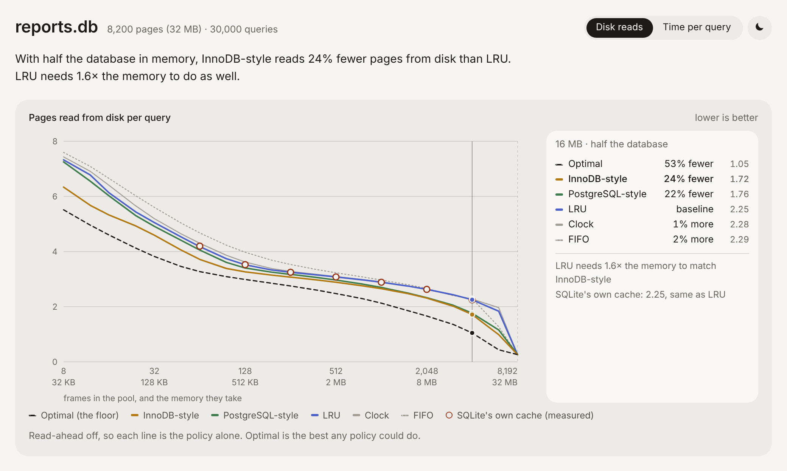
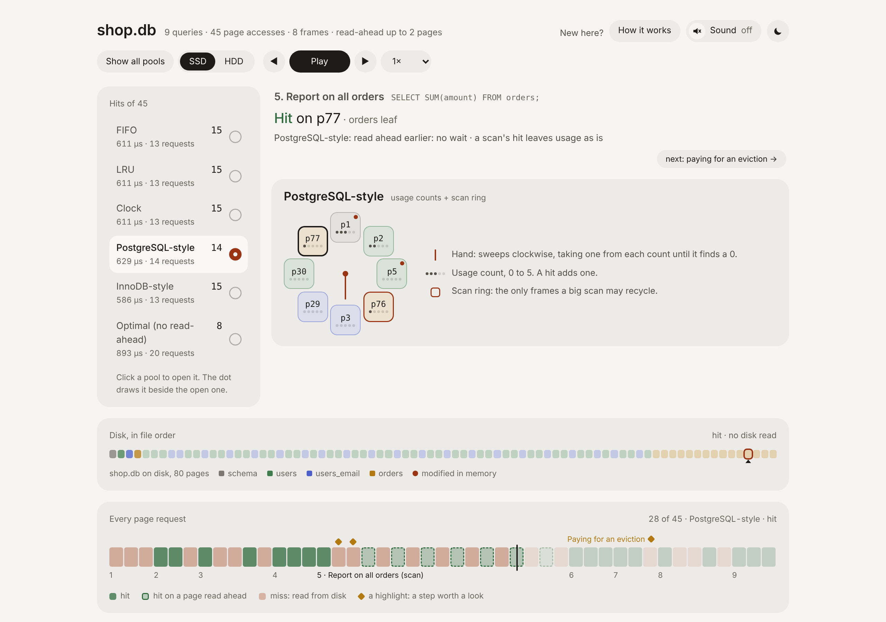

# buffer-pool-locality-sim

Replays real SQLite page reads through six buffer-pool eviction policies, to
see how much memory each one needs for the same work.



## What it found

<!-- findings:headline -->
On `reports`, a workload with periodic full-table reports, InnoDB-style and PostgreSQL-style eviction read 16–30% fewer pages from disk than LRU with half the database in memory, and LRU needs 1.4–1.6× the memory to match. Without the reports, PostgreSQL-style is within 3% of LRU.
<!-- /findings:headline -->
Two more findings and the full numbers: [FINDINGS.md](FINDINGS.md).

## How it works

- `capture/` runs a scenario in SQLite through a VFS that logs every page read
  and write, and saves it as a trace.
- `sim/` (Rust) replays the trace through FIFO, LRU, Clock, PostgreSQL-style
  (clock sweep with a scan ring), InnoDB-style (midpoint insertion) and
  Optimal, on a modelled SSD or HDD.
- It writes either a sweep across pool sizes (above) or a viewer that steps
  through every access and explains each eviction (below).



## How it's checked

- An independent Python model replays every shipped trace, and the engine must
  agree with it exactly. A fuzzer does the same on random traces.
- The engine's LRU reads within 1% of the pages SQLite's own page cache reads
  on the same queries, and within 0.1% from 256 pages up.
- `verify/findings.py --check` recomputes every number in FINDINGS.md and in
  the section above, and fails if a claim stops holding.

## Run it

Needs Rust 1.85+ and Python 3.11+ with `pip install -r capture/requirements.txt`.

```sh
cd sim && cargo build --release
./target/release/sim --trace ../traces/reports.trace.json.gz --policy all --frames sweep
./target/release/sim --trace ../traces/shop.trace.json --policy all --frames 8
```

Each run prints the folder it wrote, with `sweep.html` or `viewer.html` inside.
To capture a trace from a scenario, from the repo root (the bigger scenarios
give their exact command in their opening comment):

```sh
python capture/capture.py capture/scenarios/shop.sql -o traces/local/shop.trace.json
```

Checks: `cargo test` in `sim/`, `pytest` in `capture/`, and the scripts in
[verify/](verify/README.md).

## Layout

- `capture/`: trace capture, scenarios and their tests
- `sim/`: the engine and its command line
- `viewer/`: the two pages the engine fills in
- `verify/`: checks that don't trust the engine's own tests
- `traces/`: committed traces (big ones and variants go in `traces/local/`)

## Limits

The workloads were written for this project, and the InnoDB- and
PostgreSQL-style policies are models of those systems' eviction, not the
systems. [FINDINGS.md](FINDINGS.md) says what the findings do and don't cover.
