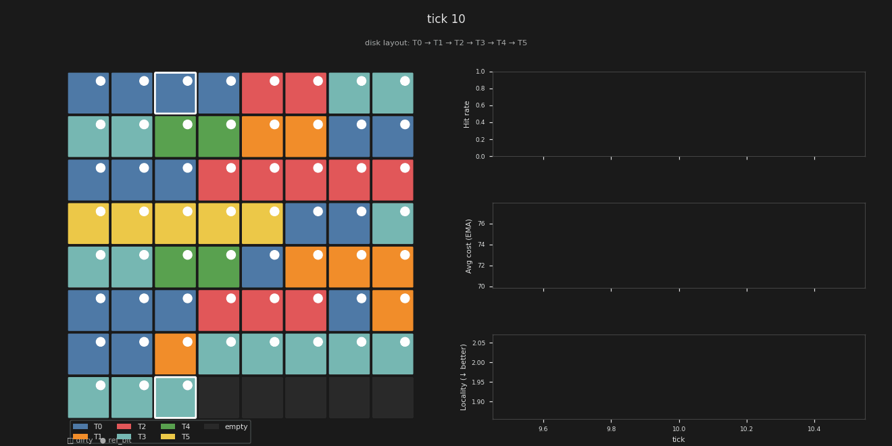

# db-locality-sim

A database buffer pool simulator that demonstrates how **physical table clustering** affects I/O cost. The simulator tracks query co-access patterns and periodically reclusters tables on disk into an arrangement that minimizes weighted seek distance.

## Motivation

UBC's Computer Hardware and Operating Systems course provided an interesting idea of how real database systems manage memory dynamically, not just through simple caching but through access-aware buffer pool policies and workload driven optimization.

These mechanisms are critical for performance, yet they are difficult to observe directly. This project was motivated by a desire to make those internal behaviours visible. I wanted to build a small-scale simulation to provide an intuitive, time-evolving view of how memory locality emerges and how buffer management policies influence performance.

## What it shows

Databases that store frequently-joined tables physically close together on disk incur lower seek costs when those joins run. This simulator makes that measurable:

| metric | no reclustering | with reclustering | delta |
|---|---|---|---|
| avg I/O cost (EMA) | 87.4 | 82.3 | **−5.9%** |
| locality score (↓ better) | 2.02 | 1.16 | **−43%** |

Both runs start from the same randomly scrambled disk layout (same seed → fair comparison).

## Visualizations

| Reclustering enabled | Baseline (no reclustering) |
|---|---|
|  |  |

*Gold vertical lines mark recluster events. Disk layout shown below each frame title.*

## How it works

**Simulator** (`sim/` — Rust)
- 64-frame buffer pool with **clock page replacement**
- Tracks co-access counts between every table pair across queries
- On recluster events: solves **Minimum Linear Arrangement** (brute-force over 6! = 720 permutations) to find the slot ordering that minimizes `Σ co_access(a,b) × |slot(a) − slot(b)|`
- Miss cost = base (10) + **seek cost** proportional to disk distance from last fetched page + dirty write penalty (20)

**Visualizer** (`viz/` — Python / matplotlib)
- Renders each snapshot as a frame: buffer pool grid on the left, rolling time-series (hit rate, avg cost EMA, locality score) on the right
- Assembles frames into a GIF via `imageio`

## Running

### Simulator

```bash
cd sim
cargo build --release

# baseline (no reclustering)
./target/release/sim --recluster=false --seed 42

# with reclustering
./target/release/sim --recluster=true --seed 42
```

Snapshots are written to `outputs/runs/{recluster|no_recluster}/<timestamp>/snapshots/`.

**CLI flags**

| flag | default | description |
|---|---|---|
| `--seed` | 42 | RNG seed (use same seed for A/B) |
| `--ticks` | 5000 | simulation length |
| `--frames` | 64 | buffer pool size |
| `--recluster` | true | enable/disable reclustering |
| `--recluster-every` | 500 | ticks between recluster events |
| `--snapshot-every` | 10 | ticks between snapshot writes |

### Visualizer

```bash
cd viz
pip install -r requirements.txt
python render.py ../outputs/runs/recluster/<timestamp>
python render.py ../outputs/runs/no_recluster/<timestamp>
```

Output GIF is written next to the run directory as `<timestamp>.gif`.
